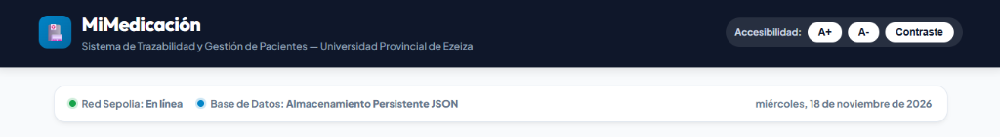
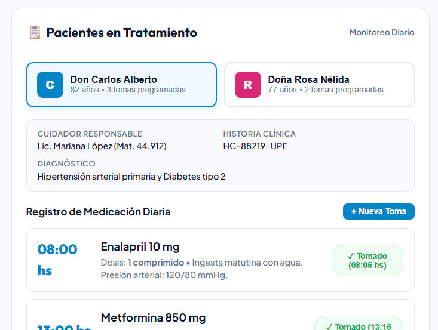
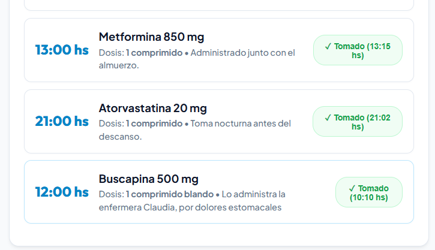
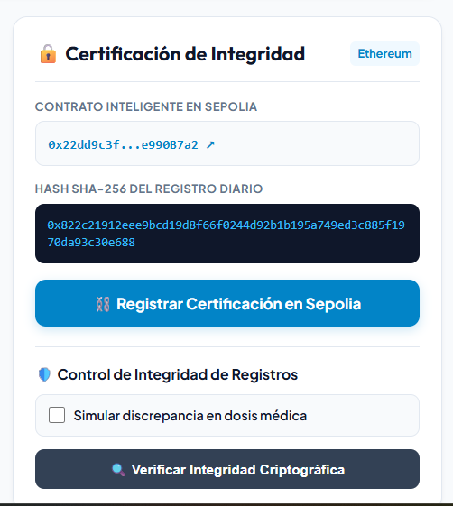

# 🏥 INFORME TÉCNICO DE PROYECTO: MiMedicación
## Notariado Criptográfico e Inmutabilidad de Prescripciones Farmacológicas para Adultos Mayores

> **Institución:** Universidad Provincial de Ezeiza (UPE)  
> **Cátedra:** Blockchain y Sistemas Distribuidos  
> **Smart Contract (Sepolia):** [`0x22dd9c3fFd0b6C0C920286a5634b9E67e990B7a2`](https://sepolia.etherscan.io/address/0x22dd9c3fFd0b6C0C920286a5634b9E67e990B7a2)  
> **Patrón Arquitectónico:** Data Anchoring Híbrido (Off-Chain / On-Chain)  
> **Cumplimiento Legal:** Ley 25.326 de Protección de Datos Personales (Argentina)  
> **Fecha de Emisión:** Noviembre 2026  

---

## 📑 Índice General
1. [Resumen Ejecutivo y Problemática](#1-resumen-ejecutivo-y-problemática)
2. [El Dilema Ético y Legal: ¿Por qué Data Anchoring?](#2-el-dilema-ético-y-legal-por-qué-data-anchoring)
3. [Arquitectura del Sistema (Off-Chain vs On-Chain)](#3-arquitectura-del-sistema-off-chain-vs-on-chain)
4. [Flujo Completo de Casos de Uso del Sistema](#4-flujo-completo-de-casos-de-uso-del-sistema)
   - [CU-01: Monitoreo de Infraestructura y Accesibilidad Inclusiva](#cu-01-monitoreo-de-infraestructura-y-accesibilidad-inclusiva)
   - [CU-02: Consulta Confidencial de Fichas Clínicas y Cronogramas](#cu-02-consulta-confidencial-de-fichas-clínicas-y-cronogramas)
   - [CU-03: Registro Dinámico de Prescripciones de Emergencia](#cu-03-registro-dinámico-de-prescripciones-de-emergencia)
   - [CU-04: Cierre Diario y Notariado Inmutable en Sepolia](#cu-04-cierre-diario-y-notariado-inmutable-en-sepolia)
   - [CU-05: Protección de Inviolabilidad (Rechazo de Sobreescritura)](#cu-05-protección-de-inviolabilidad-rechazo-de-sobreescritura)
   - [CU-06: Auditoría Forense y Detección de Fraude por Efecto Avalancha](#cu-06-auditoría-forense-y-detección-de-fraude-por-efecto-avalancha)
5. [Decisiones de Ingeniería de Software & Smart Contracts](#5-decisiones-de-ingeniería-de-software--smart-contracts)
6. [Conclusiones del Proyecto](#6-conclusiones-del-proyecto)

---

## 1. Resumen Ejecutivo y Problemática

El envejecimiento poblacional en Argentina y el mundo plantea desafíos críticos en la administración de tratamientos médicos crónicos (hipertensión, diabetes, afecciones cardíacas). En residencias de larga estadía o en el ámbito domiciliario, la administración de medicamentos recae en **cuidadores familiares o personal de enfermería**.

En este contexto surgen tres problemas operativos y legales de alta gravedad:
1. **Negligencias u Olvidos:** Falta de certeza sobre si el fármaco fue efectivamente suministrado a la hora indicada.
2. **Adulteración de Registros:** En bases de datos tradicionales, cualquier operador o administrador con permisos puede alterar retroactivamente una hora o dosis tras un incidente médico para evadir responsabilidades.
3. **Disputas de Responsabilidad:** Conflictos entre médicos tratantes, cuidadores y familiares ante sobredosis o cuadros de intoxicación por falta de una fuente de verdad objetiva.

**MiMedicación** resuelve esta problemática combinando una interfaz de **accesibilidad extrema** para la tercera edad con un **notario digital criptográfico descentralizado** montado sobre la red Ethereum (Testnet Sepolia).

---

## 2. El Dilema Ético y Legal: ¿Por qué Data Anchoring?

Un enfoque ingenuo sugeriría almacenar la lista de medicamentos de cada paciente directamente dentro de transacciones de Ethereum. Como ingenieros de software, identificamos que dicho enfoque es **inviable y contraproducente**:

> ⚠️ **Restricción Legal Absoluta (Ley 25.326 y Secreto Médico):**  
> Los datos de salud humana son considerados **Datos Sensibles**. La blockchain pública es transparente y perpetua. Una vez minado un bloque, la información jamás puede ser eliminada, lo que viola flagrantemente el **Derecho al Olvido**, el Secreto Profesional y las normativas de privacidad nacionales e internacionales (GDPR / HIPAA).

Para solucionar esto, aplicamos el patrón **Data Anchoring (Anclaje de Datos)**:
- **Off-Chain (Privado):** Los nombres, diagnósticos, dosis e historias clínicas se resguardan confidencialmente en la base de datos (MongoDB Atlas / Almacenamiento Persistente).
- **Proceso Criptográfico:** A las 23:59 hs, el backend serializa las tomas de manera determinista y calcula una huella matemática: un **Hash SHA-256 de 32 bytes**.
- **On-Chain (Público):** A la blockchain de Ethereum solo se envía el hash. Matemáticamente es imposible deducir los medicamentos a partir del hash (resistencia a preimagen), pero si alguien modifica un solo carácter de la base de datos, el fraude queda expuesto inmediatamente.

---

## 3. Arquitectura del Sistema (Off-Chain vs On-Chain)

```text
┌────────────────────────────────────────────────────────────────────────┐
│                   CAPA OPERATIVA PRIVADA (OFF-CHAIN)                   │
│                                                                        │
│   [Cuidador / Adulto Mayor]                                            │
│              │                                                         │
│              ▼                                                         │
│   [Base de Datos: MongoDB Atlas Cloud / Local]                         │
│   - Registro clínico diario: Paciente, Dosis, Horarios, Cuidador       │
└───────────────────────────────────┬────────────────────────────────────┘
                                    │ 23:59hs: Cierre Diario
                                    │ Generación de Hash SHA-256 (32 bytes)
                                    ▼
┌────────────────────────────────────────────────────────────────────────┐
│                   CAPA DE CONFIANZA PÚBLICA (ON-CHAIN)                 │
│                                                                        │
│   [Smart Contract: RegistroMedicacion.sol en Sepolia]                  │
│   - Dirección: 0x22dd9c3fFd0b6C0C920286a5634b9E67e990B7a2             │
│   - Sella únicamente: mapping(pacienteId => fecha => bytes32)          │
│   - Notario digital descentralizado e inalterable (onlyOwner)          │
└───────────────────────────────────┬────────────────────────────────────┘
                                    │
                                    ▼
┌────────────────────────────────────────────────────────────────────────┐
│                   CAPA DE AUDITORÍA FORENSE Y LEGAL                    │
│                                                                        │
│   - Cotejo matemático mediante función verificarHash()                 │
│   - Coincide 100% => Integridad Confirmada                             │
│   - Difieren hashes => Alerta Crítica de Fraude / Manipulación        │
└────────────────────────────────────────────────────────────────────────┘
```

---

## 4. Flujo Completo de Casos de Uso del Sistema

A continuación se detalla la secuencia operacional de MiMedicación, ilustrada con las evidencias capturadas directamente de la ejecución del sistema:

---

### CU-01: Monitoreo de Infraestructura y Accesibilidad Inclusiva

- **Actor Principal:** Adulto Mayor / Cuidador / Auditor.
- **Descripción:** El sistema verifica de forma autónoma la salud de las conexiones distribuidas y adapta la interfaz para personas con visión reducida o motricidad fina limitada.



#### Secuencia Técnica:
1. Al cargar la aplicación, se consulta el endpoint `/api/info`.
2. Se corrobora la disponibilidad del nodo RPC de **Ethereum Sepolia** (`Chain ID: 11155111`) y el motor de base de datos conectado.
3. Se despliegan controles de accesibilidad:
   - **Botones A+ / A-:** Escalado dinámico de tipografía (desde 14px hasta 24px) manipulando variables CSS globales.
   - **Botón Contraste:** Conmutación a paleta cromática de alta polaridad (fondo `#000000`, textos `#ffffff` y enlaces en cian) según las pautas WCAG 2.1.

---

### CU-02: Consulta Confidencial de Fichas Clínicas y Cronogramas

- **Actor Principal:** Cuidador Matriculado / Enfermero de Turno.
- **Descripción:** Acceso a la agenda farmacológica individualizada por paciente, protegiendo los diagnósticos médicos fuera de la red pública.



#### Secuencia Técnica:
1. El usuario selecciona la pestaña correspondiente (ej: *Don Carlos Alberto Martínez, 82 años*).
2. El sistema recupera de la base de datos privada:
   - Identificador formal (`PAC_001`).
   - Historia Clínica hospitalaria (`HC-88219-UPE`).
   - Diagnóstico base: *Hipertensión arterial primaria y Diabetes tipo 2*.
   - Cuidadora responsable matriculada: *Lic. Mariana López (Mat. 44.912)*.
3. Se despliega el pastillero horario digital:
   - **08:00 hs:** Enalapril 10 mg (`✓ TOMADO 08:05 hs`).
   - **13:00 hs:** Metformina 850 mg (`✓ TOMADO 13:15 hs`).
   - **21:00 hs:** Atorvastatina 20 mg (`✓ TOMADO 21:02 hs`).

---

### CU-03: Registro Dinámico de Prescripciones de Emergencia

- **Actor Principal:** Profesional de la Salud / Enfermero a Domicilio.
- **Descripción:** Capacidad de incorporar un fármaco de rescate o una indicación médica extraordinaria, impactando en tiempo real en la base de datos y recalculando la huella digital del paciente.



#### Secuencia Técnica:
1. El profesional acciona el botón **`+ Nueva Toma`**.
2. Completa los datos en el modal estructurado:
   - **Medicamento:** *Buscapina 500 mg*.
   - **Dosis:** *1 comprimido blando*.
   - **Hora:** *12:00 hs*.
   - **Observaciones:** *Lo administra la enfermera Claudia por dolores estomacales (`10:10 hs`)*.
3. Al enviar el formulario, el endpoint `POST /api/tomas` valida y persiste el registro en la base de datos.
4. **Reactividad Criptográfica:** El frontend detecta la modificación de los datos locales y regenera de inmediato la preimagen hash SHA-256 en pantalla:
   $$\text{Hash}_{\text{nuevo}} = \text{SHA-256}(\text{JSON}_{\text{canónico}}(\text{tomas} + \text{Buscapina}))$$

---

### CU-04: Cierre Diario y Notariado Inmutable en Sepolia

- **Actor Principal:** Backend Automatizado (Cron Daemon a las 23:59 hs) o Disparo Manual por Administrador.
- **Descripción:** Sellar en la blockchain pública la prueba temporal irrefutable del conjunto de tomas administradas durante el día.



#### Secuencia Técnica:
1. El backend toma el objeto consolidado del paciente y lo procesa mediante `canonicalizarObjeto()` para evitar que discrepancias de ordenamiento en claves alteren el digest.
2. Genera el hash hexadecimal con prefijo `0x` (ejemplo de la captura):
   ```text
   0x822c21912eee9bcd19d8f66f0244d92b1b195a749ed3c885f1970da93c30e688
   ```
3. La cuenta autorizada del servidor firma la transacción y llama a:
   ```solidity
   registroMedicacion.registrarHash("PAC_001", "2026-11-18", 0x822c2191...);
   ```
4. Los validadores de Sepolia minan la transacción, confirmándola en un bloque con su correspondiente marca de tiempo (`block.timestamp`) y emitiendo el evento:
   ```solidity
   emit HashRegistrado("PAC_001", "2026-11-18", hashRegistro, block.timestamp);
   ```

---

### CU-05: Protección de Inviolabilidad (Rechazo de Sobreescritura)

- **Actor:** Cuidador infiel, Administrador corrompido o Atacante externo.
- **Descripción:** Intento deliberado de reenviar o sobreescribir la información de una fecha ya notariada para tapar un error médico o una alteración de horarios.

#### Evidencia de Ejecución en Consola:
```text
[API /api/anclar] Anclando registro para PAC_001... Hash: 0x24390d13...
[BlockchainService] Error al registrar hash en blockchain: execution reverted (unknown custom error) (action="estimateGas", data="0x926151ca...")
[API /api/anclar] Error: Conflicto de inmutabilidad: El registro para el paciente 'PAC_001' en la fecha '2026-11-18' ya ha sido anclado previamente.
```

#### Fundamento del Smart Contract:
El selector `0x926151ca` corresponde al Custom Error:
```solidity
error RegistroYaExistente(string pacienteId, string fecha);
```
Al evaluar que `_registros[pacienteId][fecha].existe == true`, la Máquina Virtual de Ethereum aborta la ejecución inmediatamente sin modificar el almacenamiento. **El pasado no puede ser reescrito bajo ninguna circunstancia.**

---

### CU-06: Auditoría Forense y Detección de Fraude por Efecto Avalancha

- **Actor Principal:** Perito Judicial / Auditor del Ministerio de Salud / Familiar del Paciente.
- **Descripción:** Verificar matemáticamente si el registro médico almacenado en los servidores coincide con la verdad sellada en la blockchain, o si sufrió alguna alteración humana.

#### Procedimiento de Prueba:
1. **Verificación de Registro Genuino:**
   - Se pulsa **`🔍 Verificar Integridad Criptográfica`**.
   - El sistema calcula el hash del registro actual y llama a la función `view` `verificarHash(pacienteId, fecha, hash)`.
   - Resultado: **`🛡️ INTEGRIDAD MATEMÁTICA CONFIRMADA`**.

2. **Simulación de Ataque (Efecto Avalancha):**
   - Se activa la casilla: *`[X] Simular discrepancia en dosis médica`*.
   - El sistema modifica un único carácter: sustituye `"Enalapril 10 mg"` por `"Enalapril 20 mg"`.
   - Debido a las propiedades matemáticas de SHA-256, cambiar 1 solo dígito altera por completo los 256 bits resultantes:
     ```text
     Hash Legítimo : 0x822c21912eee9bcd19d8f66f0244d92b1b195a749ed3c885f1970da93c30e688
     Hash Alterado : 0x24390d136e7a099e17c0dfbc144f3b4580875db9890af4a6d3ac22e764cc8eab
     ```
   - Al cotejar contra Sepolia, la función retorna `false` y la aplicación emite una alarma crítica:  
     **`🚨 ALERTA CRÍTICA: FRAUDE O ALTERACIÓN DETECTADA (Los datos discrepan del certificado en Sepolia)`**.

---

## 5. Decisiones de Ingeniería de Software & Smart Contracts

| Componente | Decisión Técnica Adoptada | Justificación de Ingeniería y Beneficio |
| :--- | :--- | :--- |
| **Tipo de Dato Hash** | `bytes32` en lugar de `string` | SHA-256 genera 256 bits exactos. En la EVM, `bytes32` cabe en un único storage slot de 32 bytes (20.000 gas inicial). Un `string` dinámico overhead de longitud y punteros, encareciendo el gas en más de 40%. |
| **Control de Acceso** | `onlyOwner` (OpenZeppelin v5) | Evita que cualquier nodo o bot en internet pueda inyectar hashes falsos a nombre de pacientes del hospital. Solo la wallet institucional del backend puede certificar. |
| **Manejo de Revert** | *Custom Errors* (`error ...()`) | Introducidos en Solidity 0.8.4. Almacenan solo un selector de 4 bytes en vez de strings literales largos, reduciendo el tamaño del bytecode y el gas de reversión. |
| **Indexación de Eventos** | `indexed pacienteId, indexed fecha` | Permite a sistemas externos de auditoría o dashboards consultar eventos en milisegundos mediante filtros RPC (`eth_getLogs`) sin iterar sobre el storage del contrato. |
| **Criptografía Backend** | Módulo nativo `crypto` de Node.js | Evita librerías de terceros susceptibles a vulnerabilidades en la cadena de suministro. Algoritmo estándar FIPS 180-4. |
| **Infraestructura Cloud** | MongoDB Atlas M0 + Vercel | Arquitectura Serverless de alta disponibilidad, con costo de infraestructura de **$0.00 USD** reales. |

---

## 6. Conclusiones del Proyecto

1. **Viabilidad del Notariado en Salud:** Se demostró de manera concluyente que la tecnología Blockchain puede aplicarse al ámbito sanitario sin colisionar con las normativas de secreto médico (Ley 25.326), gracias a la separación estricta entre la capa de datos sensibles (off-chain) y la capa notarial matemática (on-chain).
2. **Inmutabilidad como Escudo Legal:** El Smart Contract `RegistroMedicacion.sol` actúa como un perito informático neutral y desinteresado, protegiendo tanto a los adultos mayores de negligencias como a los cuidadores profesionales de acusaciones infundadas.
3. **Eficiencia y Sostenibilidad:** La optimización a nivel de bytecode y el uso de `bytes32` garantizan que el sistema sea viable para escalar a miles de pacientes en redes de Capa 2 (L2) o Testnets sin representar una carga financiera.

---

```
                       UNIVERSIDAD PROVINCIAL DE EZEIZA
                   Carrera: Licenciatura en Desarrollo de Software
                    Cátedra: Blockchain y Sistemas Distribuidos
```
